# PuzzleHuntBot User Guide

PuzzleHuntBot is Quarantine Decrypter's puzzle-hunt organisational aide. It keeps three
things in sync for you during a hunt:

- **Discord** — a category and channel for every round and puzzle, so discussion stays
  organised and findable.
- **Google Sheets** — a spreadsheet tab for every puzzle, created automatically, plus
  roll-up tabs that gather feeder answers under their meta.
- **The web dashboard** — a live website showing every puzzle's status, with buttons for
  almost everything the chat commands can do.

You drive the bot with `!` chat commands in Discord (most also work as `/` slash
commands), or with the dashboard in your browser. Both do the same thing underneath, so
use whichever is closer to hand.

> **Getting help in Discord:** `!help` lists every command; `!help solve` (or any command
> name) shows its usage and examples.

---

## 1. The basics — a puzzle's life

### Where things live

Each hunt is a set of Discord categories: one per round (or "group"), plus a `solved`
area. Every puzzle gets **its own text channel** and **its own sheet tab**. The channel's
pinned info message links to the puzzle page, the sheet tab, and shows the current
status — if the pin gets stale, `!info` refreshes it.

### Creating a puzzle

In the hunt's main channel or a round channel:

```
!p Puzzle Name
```

The bot creates the channel, makes the sheet tab, and posts a welcome message with all
the links. If you create it in a round channel, the puzzle lands in that round.

### Telling the bot where the puzzle is

If the guessed puzzle URL is wrong (it usually guesses from the hunt URL and puzzle
name), fix it from the puzzle's channel:

```
!link https://hunt.example/puzzles/actual-page
```

### Solving

All from the puzzle's own channel:

| You want to… | Command |
|---|---|
| Record the answer | `!s ANSWER` (alias of `!solve`) |
| Record a partial/intermediate answer | `!partial ANSWER` |
| Mark solved when there's no text answer | `!mark_as_complete` |
| Add a second valid answer | `!add_solution ANSWER` |
| Replace a wrong recorded answer | `!change_solution ANSWER` |
| Undo a solve | `!unsolve` |

On `!s` the bot records the answer, updates the sheet, celebrates in channel, and moves
the channel to the solved section (and, if the hunt uses a separate solved-puzzles
spreadsheet, moves the tab there). Solved feeder answers appear automatically on their
meta's roll-up.

The bot also posts one line in the channel of every meta the puzzle **feeds** (a mini's
minimeta included), e.g. `✅ #feeder solved: APPLE`, so meta solvers see answers arrive
without watching the sheet. Added answers, corrected answers and unsolves are posted the same
way, from Discord or the dashboard alike. Partials and informs-only tags stay quiet, and
nobody is pinged.

---

## 2. Keeping the team informed

These all run in the puzzle's channel and show up on the pinned info, the sheet, and the
dashboard:

- `!status VALUE` — one of *Unstarted, In Progress, Stuck, Needs Extraction, Needs
  Submission, Solved, Backsolved*. The case you type does not matter.
  (*Unsolved* and *Partially Solved* also appear on puzzles, but they are set by the
  solve/unsolve/partial commands rather than by `!status`.)
- `!priority VALUE` — *low, medium, high, very high*.
- `!type VALUE` — freeform label like `crossword` or `image quiz` (the slash version
  autocompletes types already used this hunt).
- `!note some text` — add a note; `!notes` lists them; `!erase_note 2` removes one.
- `!clue some fact` — log a clue/observation to the hunt's shared **Evidence** sheet
  tab; attach an image to log a picture instead of or alongside the text
  (`!clues "multi word one" second third` logs several text clues at once, still
  from a puzzle channel). Unlike the rest of this list, `!clue` also works outside a
  puzzle channel — use that for a hunt-wide fact that doesn't belong to any one
  puzzle's notes; it's logged with no source puzzle.
- `!list_puzzles` — list the puzzles in the current round with status and answers.

---

## 3. Rounds, metas and groups

### Creating them

Run in the hunt's main channel:

| Command | Creates |
|---|---|
| `!r Round Name` | A **round** — new category plus a `Round Name - meta` puzzle |
| `!mp Meta Name` | A **metapuzzle** |
| `!cs Name` | A **capstone** (fed by *information* rather than answers) |
| `!ra Name` | A **runaround** (an end-of-hunt group) |
| `!group Name` | A plain **group** — a category with no meta puzzle |

Every group gets a **6-character group code** (shown on its pinned info, e.g. `SULXHX`).
Commands that point at a group take this code — or just the group's name (or a unique
part of it); the bot will list candidates if it's ambiguous. Slash commands autocomplete
the codes for you.

### Tagging puzzles into groups

Run these in the **puzzle's** channel, naming the target group:

- `!feeds CODE` — this puzzle **feeds** the group's meta: its *answer* contributes.
  `!feeds_only CODE` additionally clears any other feeds-tags and moves the channel into
  that group's category. (Aliases: `!add_to_meta`, `!move_to_meta`.)
- `!informs CODE` — this puzzle **informs** the target: it contributes *information*
  rather than its answer (this is what makes a target a capstone). Can be used before
  the puzzle is even solved.
- `!groups_with CODE` — group the puzzle for tidiness without contributing to any meta.
- `!remove_from CODE` — take the puzzle out of a group.

A puzzle can feed more than one meta — tag it once per meta. The meta's roll-up sheet
gathers whatever feeds it: answers from `feeds` tags, facts from `informs` tags.

### Changing your mind about what a puzzle is

Target channels carry a leading emoji so you can spot them in the channel list: 🧩 a
metapuzzle, 🧩🧩 a meta whose feeders are themselves metas, 👑 a capstone, 🏃 a runaround.
Plain feeders have none. New and converted targets get their glyph automatically; for a
hunt created before this feature, an organiser can run `!backfill_glyphs` once to add them.

From the puzzle's channel (organisers/mods): `!convert_to_meta`, `!convert_to_capstone`,
`!convert_to_runaround`, `!convert_to_group`, `!convert_to_metapuzzle`,
`!convert_to_puzzle` — promote a feeder to a meta, turn a meta back into a plain
puzzle, and so on. Feeders and their tags survive the conversion.

Giving a meta its own category: `!extract_target_to_category` (run in the meta's own
puzzle channel) moves that meta and the puzzles that feed *only* it into a fresh Discord
category — useful when a meta you promoted in place has outgrown the category it was
sharing. Shared feeders and nested metas stay where they are.

The reverse is `!consolidate_to <destination>`: run in the meta's own puzzle channel, it
moves the meta and its puzzles into the destination round's category and deletes this
meta's category — handy when you're short on categories but have channel room to spare. If
the destination would overflow, the bot asks you to confirm first.

You usually won't need to run `!extract_target_to_category` by hand: when a category fills
up, the bot automatically extracts a promoted-in-place meta into its own category (the one
you're adding to, or the fullest nested meta in the round) so puzzle creation keeps working
instead of erroring. It only does this when it actually frees up space.

Renames: `!rename_puzzle New Name` (puzzle channel) and `!rename_group New Name`
(group's channel). Deletion (`!delete_puzzle`, `!delete_round`, `!delete_hunt`) always
asks for confirmation — and really does delete channels and sheets.

---

## 4. Minimetas

For puzzles that contain a cluster of mini-puzzles, each wanting its own sheet but not
its own channel:

```
!make_minimeta          (in the puzzle's channel)
!add_mini Mini Name     (adds a mini: a thread + its own sheet)
!list_minis             (numbered list with solve state)
!solve_mini 2 ANSWER
!unsolve_mini 2
!delete_mini 2          (deletes one mini — or run it with no number in the mini's thread)
!remove_minimeta        (revert to an ordinary puzzle — deletes the minis)
```

Minimeta puzzles show a `MINIMETA` badge and a solved-count (e.g. `1/2`) on the
dashboard.

---

## 5. Extra sheets

Need a scratch sheet, a grid copy, a second workspace? From the puzzle's channel:

```
!add_sheet grid-copy
!list_sheets
!remove_sheet 1
```

---

### Files mode: one spreadsheet per puzzle

A hunt can instead give every puzzle its own Google spreadsheet. Pick it when you create the
hunt (`!hunt name:url, files`, or the **One spreadsheet per puzzle** switch under Advanced on
the dashboard's create form and server setup page). What goes where:

- The hunt gets a Drive folder named after it, with a **Solved** subfolder, and a
  `<hunt> Reference` spreadsheet in the folder. The Reference spreadsheet holds REFERENCE,
  Unassigned, Evidence and any loose hunt sheets -- not the roll-ups: a meta's or
  minimeta's roll-up table lives in that puzzle's own file.
- Each puzzle is its own file in the folder, named after the puzzle. Minis are tabs in their
  minimeta's file, and extra sheets are tabs in their puzzle's file.
- Solving a puzzle moves its file into the **Solved** folder; unsolving moves it back. The file
  keeps its link either way. If a file ends up in the wrong folder, is misnamed, or goes
  missing, `!reconcile apply` repairs it (it moves or renames a live file and only recreates
  one that is really gone; stray files in the folders are listed, never deleted).
- There is no solved spreadsheet: the solved-sheet options (`!use_solved_sheet`, the create
  checkbox, the dashboard button) don't apply, and a solved puzzle keeps its file and link.
- The mode can only be switched (`!sheet_mode files` / `tabs`, or Admin settings) while the
  hunt has no puzzles or groups.

---

## 6. The web dashboard

The dashboard shows the whole hunt at a glance and can do nearly everything the chat
commands can — create puzzles and groups, solve, retag, take notes, log clues — with the
same effects in Discord and Sheets (channels get created, pins get updated, the works).

### Logging in

Open the dashboard site and click **Log in with Discord**. It uses your Discord account
to check you're on the team; there's no separate password.

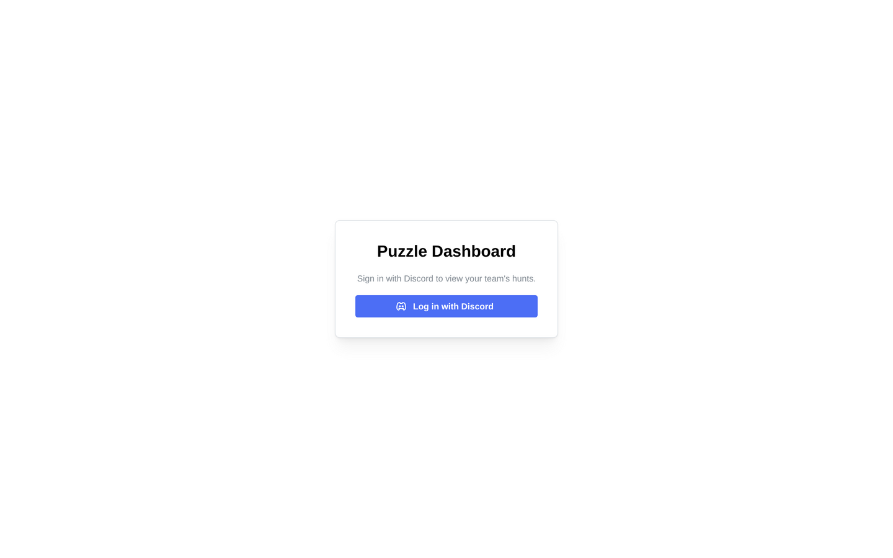

### Your hunts

The front page lists active hunts by server. Old hunts move to an archived list when
they're wrapped up. Click a hunt to open its board. Admins also get a **New hunt**
button here — no more copy-pasting the `!hunt` incantation.

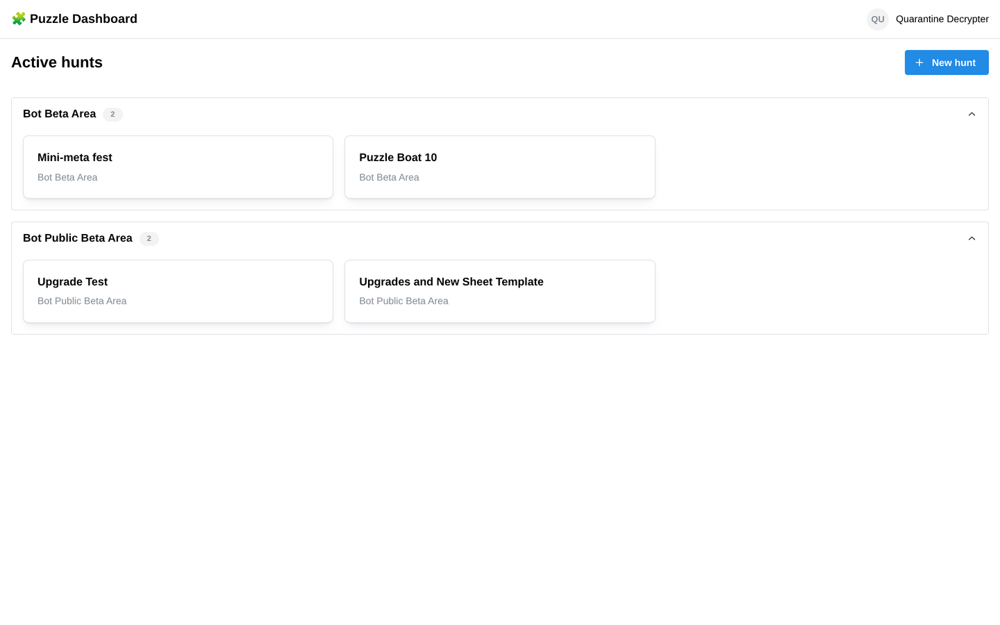

### The hunt board — "By group"

The default view groups puzzles under their meta, mirroring the Discord categories. For
each group you can see the code, feeders solved, and each puzzle's status, answer and
recent activity (with the activity bar chart described under
["All puzzles"](#all-puzzles--search-and-filter), on wider screens). Solved rows go
green and sink; solved groups collapse. For a hunt where each puzzle has its own
spreadsheet, the hunt info panel links to the hunt's **Drive folder**, which holds
them all.

The icons on each row open the puzzle's **sheet**, its **chat** (a Discord-style
window — see [Reading a puzzle's chat](#reading-a-puzzles-chat)), and the **puzzle page**
on the hunt site. The buttons on the right mark a puzzle solved or unsolved and open its
notes.

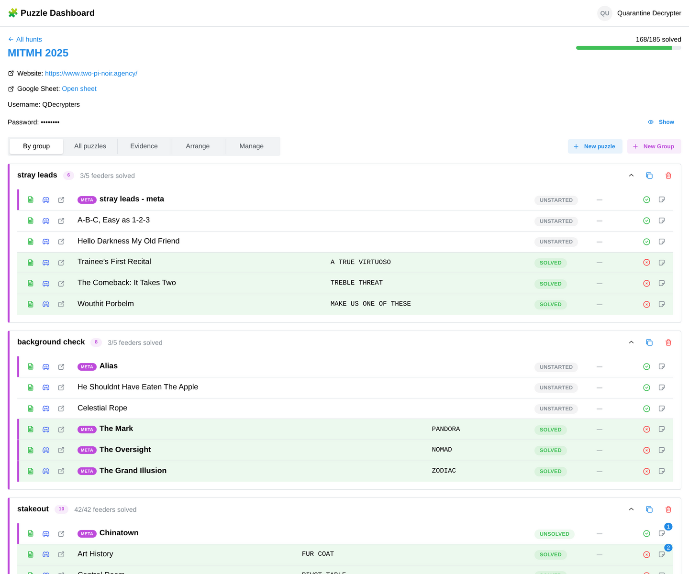

### "All puzzles" — search and filter

One flat table of every puzzle with search, and filters by status, priority and type
(plus a "hide solved" toggle). This is the quickest way to find "that puzzle with FUR
COAT in the answer" or everything currently *Stuck* or *Needs Extraction*.

The **Activity** column shows each unsolved puzzle's whole life since it was added as a
small bar chart, beside the time since anyone last chatted or edited its sheet. Bar
height is how busy the puzzle's Discord channel was; an **orange** bar means someone
(not the bot) edited the puzzle's spreadsheet then. So you can tell a puzzle nobody
has started (flat) from one people gave up on (busy, then flat) or are stuck on (a
steady trickle) without anyone having to mark it. Sheet edits only show for hunts
whose puzzles each have their own spreadsheet (files mode); history starts from when
this feature was installed.

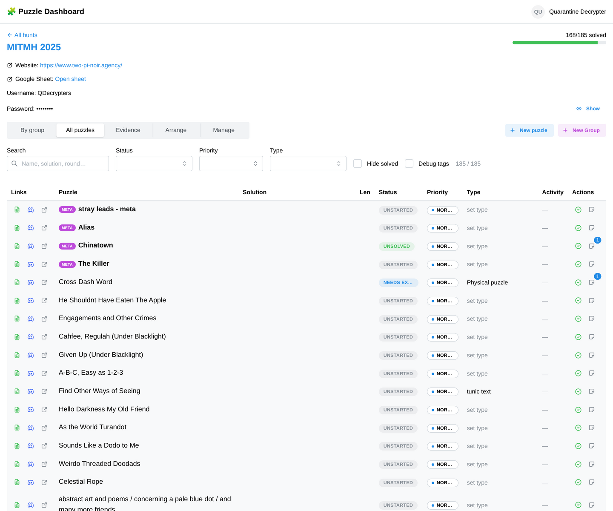

### The puzzle drawer

Click a puzzle's notes icon to open its drawer: set status, priority and type, follow
its links, mark it solved, add working sheets, and read or add notes — the same notes as
`!note` in Discord.

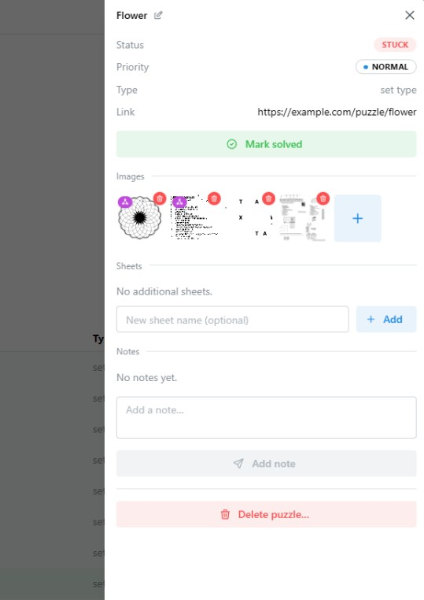

The drawer also holds the puzzle's **images** — the puzzle as a picture, rather than
clues about it. Two things put an image here:

- drawing a box round the puzzle on a **canvas** and linking it as *this section is the
  puzzle* (see [Canvas](#canvas)), which crops that part of the sheet automatically;
- adding one yourself: use **Add image**, or just **paste a screenshot** anywhere in the
  open drawer.

Click any of them to open it full-screen and **mark it up** (see [Marking up an
image](#marking-up-an-image)). Drag the thumbnails to reorder them — useful when a
puzzle is spread across several bits of a sheet and you want them in reading order.
Removing an image that came from a canvas only takes it off the puzzle; the region stays
on the sheet, and the image comes back if that region is still linked. A picture nothing
points at any more isn't deleted straight away — it is reclaimed later by the maintenance
sweep (organisers: `!media_sweep`, or the hunt's Maintenance panel), so there is a day's
grace to put it back.

### Reading a puzzle's chat

Every puzzle row has a **Discord icon** — click it to open the puzzle's **chat viewer**,
a read-only window showing that channel's discussion right inside the dashboard, rendered
Discord-style (avatars, replies, images, embeds and `:shortcode:` emoji). For a live hunt
it shows the recent history and keeps updating as people talk, with an **Open in Discord**
button to jump to the real channel. For an **archived** hunt — whose Discord channels have
been condensed into threads or deleted — it shows the **captured transcript**, so the
discussion stays readable on the dashboard long after the hunt is over.

You still talk in Discord; the dashboard only mirrors it. Capturing messages is an opt-in
feature an admin turns on when deploying; until it is enabled the viewer has no history to
show, but the **Open in Discord** button always works.

### Evidence

The hunt-wide clue log — everything recorded with `!clue`/`!clues`, filterable by source
puzzle, and you can log new clues from here too. It mirrors the Evidence tab on the hunt
spreadsheet.

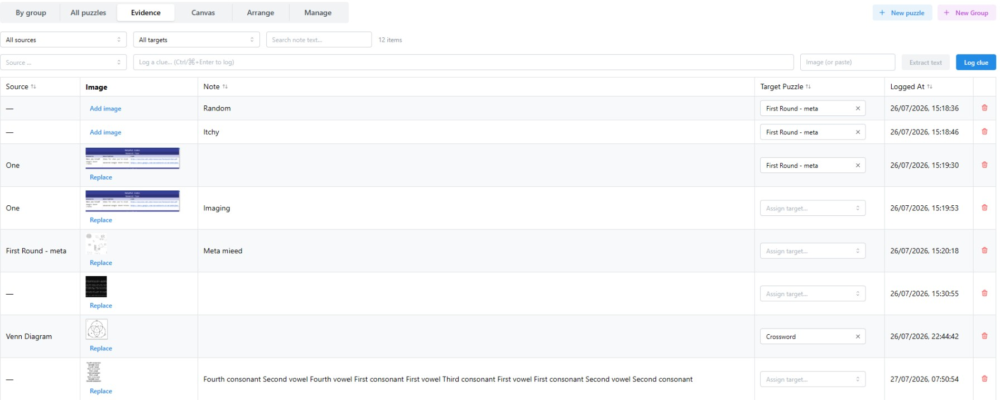

**Clues can be pictures.** When logging one, attach a file or simply **paste a
screenshot** into the clue box — the usual way you'll capture a chunk of a puzzle. A
clue can be an image with no text at all.

- **Extract text** runs the image through text recognition and offers the result for the
  note, so you don't retype a wall of letters. It asks before replacing anything you have
  already typed. It is a machine reading a picture: expect to correct it.
- Notes can run to **several lines** — Enter starts a new line, **Ctrl/⌘+Enter** logs the
  clue. That matters because extracted text usually arrives as lines that mean something.
- **Click a clue's thumbnail** to open it full-screen and mark it up (see below).
- **Replace** swaps the picture while keeping the note, the target and the row's place in
  the table — for when someone produces a clearer scan of the same thing. You can also
  click the image cell and paste. The old picture is kept, not deleted — it stays on the
  server until an organiser runs the maintenance sweep (`!media_sweep`, or the hunt's
  Maintenance panel), which reclaims pictures nothing points at any more.

The **Source** column says where a clue came from: a puzzle, a sheet, or a **canvas**
region, so a clue carved off a hunt sheet still says which part of which sheet it was.

### Canvas

Some hunts hand you one enormous image — an extravaganza sheet with forty puzzles printed
on it — rather than a puzzle per page. The **Canvas** view is for those.

An organiser uploads the image, and then anyone on the team can draw boxes round the
puzzles on it. Pan by dragging, zoom with **Ctrl+scroll** or the zoom buttons; large
sheets are served in tiles, so a 14,000-pixel-wide sheet stays usable.

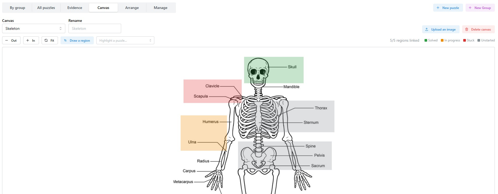

Click **Draw a region** and drag a box round something. You are then asked what it is:

- **this section is the puzzle** — the box *is* a puzzle. Its picture appears on that
  puzzle in the drawer, ready to work on.
- **this is a clue for a puzzle** — the box is evidence about some puzzle elsewhere. It
  becomes a row in the Evidence log, carrying the cropped picture with it.
- **no puzzle** — just a box for now. Perfectly reasonable while you are still working
  out what is on the sheet.

You can also **create a new puzzle straight from a box**, naming it and choosing its round
in one go; the bot makes the channel and the sheet as usual. **Extract text** works here
too, reading whatever is inside the box.

Boxes are tinted by their puzzle's status, so a glance at the sheet shows what is solved,
in progress, stuck, or not started. Hovering a box lights up every other box belonging to
the same puzzle, and the toolbar's puzzle picker pins that highlight while you hunt around
a busy sheet for the rest of it. Boxes are shared: everyone sees them as they are drawn.

In Discord, `!canvas` links to this view and lists the hunt's canvases.

### Marking up an image

Any image the dashboard holds — a clue's picture, or a puzzle's own picture in the drawer
— can be drawn on. Click its thumbnail to open it full-screen.

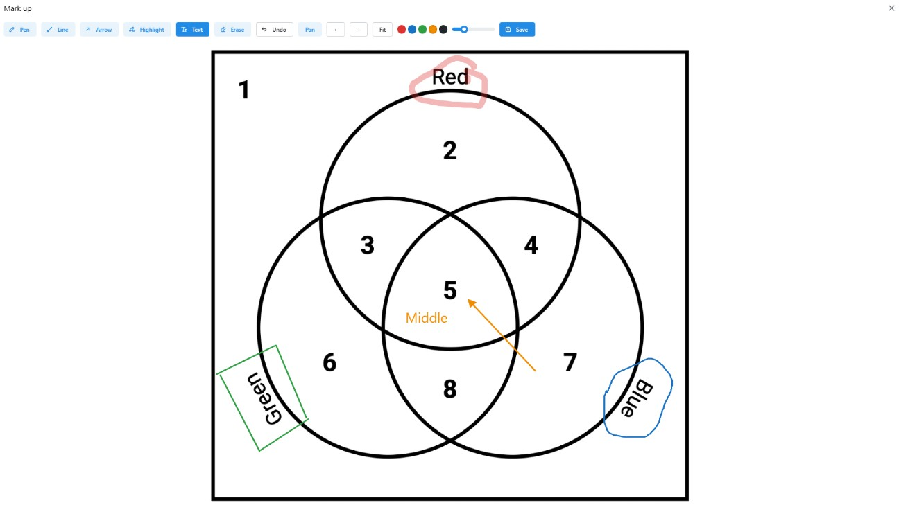

The tools are what you would expect: **pen**, **line**, **arrow**, **highlighter**,
**text** and an **eraser**, plus a colour and a size. Some details worth knowing:

- Hold **Shift** while drawing with the pen or highlighter to snap the stroke straight.
- The **size** slider sets line thickness, text size, and how wide the eraser bites.
- **Text**: click where you want it, type, then **Ctrl/⌘+Enter**.
- **Ctrl+scroll** zooms about the pointer, and **holding Ctrl** turns any tool into a drag
  to pan — the **Pan** button does the same without the key. **Fit** returns to the whole
  picture.
- The **eraser** is a circle, shown around the pointer: it takes every mark it touches, and
  you can drag it across several. Make it bigger or smaller with the size slider.
- **Undo** (**Ctrl/⌘+Z**) removes what you just drew, most recent first.
- **Save** closes the image. Marks are saved as you draw them, so nothing is lost if you
  close it another way.

Keyboard shortcuts pick a tool by its position in the toolbar: **1** pen, **2** line,
**3** arrow, **4** highlight, **5** text, **6** erase. **Tab** steps through the colours
(**Shift+Tab** goes back), and the one you are drawing in is ringed in the toolbar — so
you can change colour without letting go of the mouse. All of these are ignored while you
are typing a text mark, so a "1" mid-word will not swap the tool under you, and Tab
indents as usual. Press **Escape** to close the image.

Markup is **shared and live**: two people can annotate the same image at once and each
sees the other's marks appear. It is also purely visual — a circle round an answer is not
a clue, and never turns into one. Marks belong to the image you drew them on, so ink on a
clue's picture does not appear on the puzzle's picture, even when the two came from the
same sheet.

### Arrange (organisers)

A drag board for re-organising the hunt: drag a puzzle card onto a group to re-tag it
(its Discord channel moves too), or onto **Unassigned Feeders** to untag it. The `⋮`
menu on each card adds a puzzle to an *additional* group — that's how one puzzle feeds
two metas.

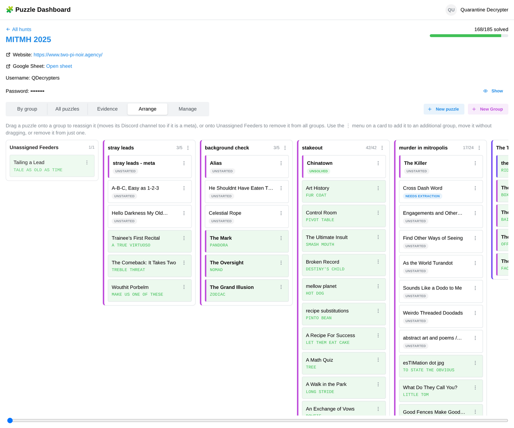

### Manage (organisers/admins)

Hunt settings (URL, start time, shared login), archiving the hunt when it's over,
gating the hunt behind a Discord team role, deleting it, and **Reconcile** — a
self-repair pass that scans for missing channels or sheet tabs and fixes them
("Report" shows a dry run first).

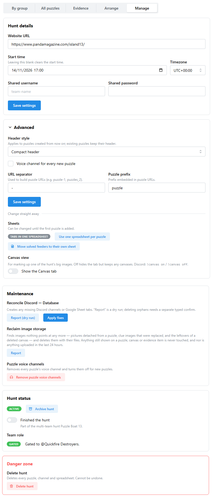

### Creating from the web

**New puzzle** and **New Group** buttons live top-right of every hunt board. Pick the
meta it belongs to (or *Unassigned*) and the bot creates the Discord channel and sheet
exactly as `!p` would.

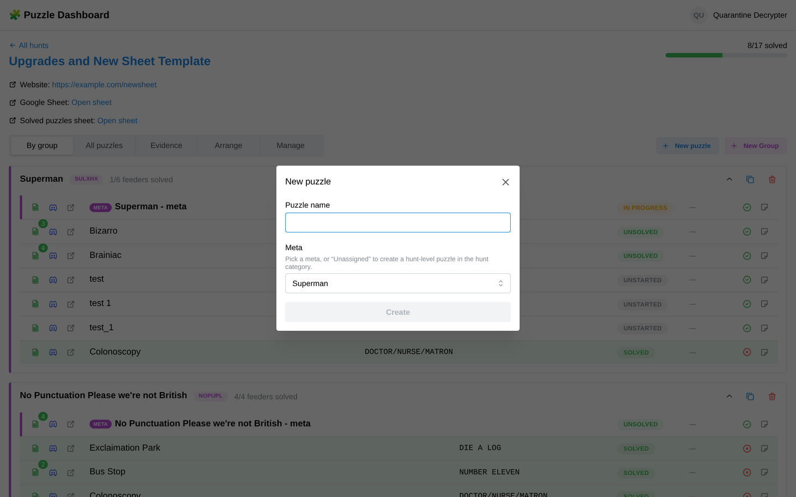

Minimetas show up with their mini-count, and their minis are managed from the puzzle's
drawer:

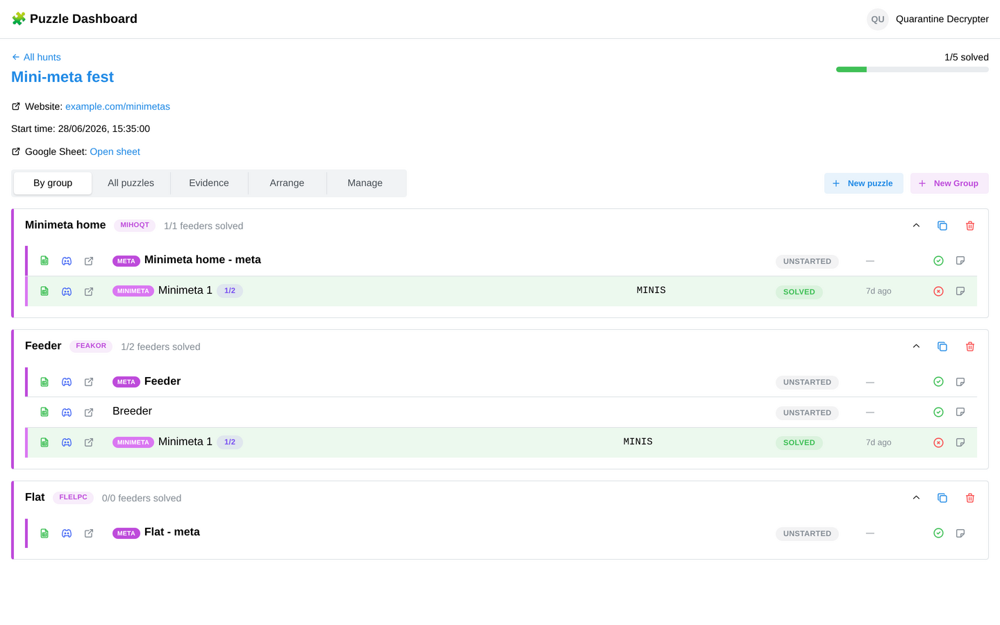

---

## 7. For organisers and admins

The full [command reference](commands.md) lists every command; highlights:

- **Server settings (dashboard):** the avatar menu → **Server settings**, for admins.
  Pins which Discord roles grant the admin and organiser tiers, and sets the bot command
  channel and Google Drive folders, and holds the team-server template link. If a tier
  still says *matched by name*, anyone who can create a role can grant themselves that
  tier — pin it.
- **Team servers (one per team per hunt):** clone the hub's template, invite the bot, drag
  its role above `mod`, then follow the link in the bot's greeting to the dashboard's setup
  page (or run `!setup_server`). The setup page can send the players' invites too. On the
  hub, Server settings → **Team servers** shows each team hunt's members, outstanding
  invites and access history (admins only). The
  [new server playbook](new-server-playbook.md#team-servers-one-per-team-per-hunt) has
  the full steps.
- **Multi-team hunts:** when several teams field the same hunt, answer **Yes** to "Are we
  fielding more than one team?" on the setup page (or end the `!setup_server` hunt name with
  `, multi-team`). Teams that use the same hunt name join one multi-team hunt, and the hub
  gets two private channels: a **no-spoiler** channel that every team's hub role and the
  hub Admin roles can see, and a **finishers** channel that only teams marked complete can see
  (roles with Discord's Administrator permission see every channel regardless). Mark a team complete with `!hunt_complete` in its hunt channel, the
  **Finished the hunt** switch in the hunt's Admin settings, or the button on Server
  settings → **Team servers**; `!hunt_not_complete` undoes it. Marking complete archives
  nothing. When the last team archives, both channels are condensed into threads on
  `{YYYY-MM} {name} - all teams` and deleted; `!archive_multi_team <hunt name>` or
  **Archive now** on the Team servers page does it sooner, but only once every team has
  archived to the hub. If the last team's hunt was deleted rather than archived, the
  dashboard group disappears, so use `!archive_multi_team` for that case.
- **Standing up a new Discord server for a hunt:** follow the
  [new server playbook](new-server-playbook.md) — it covers the two steps nothing in the
  code performs, pinning the admin/organiser roles (`!set_admin_roles`) and setting the
  team role's overwrite on the hunt's initial category.
- **Starting a hunt:** `!hunt Hunt Name:https://hunt.example` in the bot channel.
  Append `, RoleName` to gate the hunt to a team role, and `, files` for
  [one spreadsheet per puzzle](#files-mode-one-spreadsheet-per-puzzle). Then `!set_start TIMESTAMP` and
  `!set_login user:pass` if the hunt has a shared login, and `!use_solved_sheet` if you
  want solved puzzles moved to a second spreadsheet to keep the main one fast.
- **Keeping things tidy mid-hunt:** `!sync` (in a group's channel) tags every channel in
  the category into the group; `!rebuild` regenerates meta roll-up sheets;
  `!reconcile apply` heals any drift between Discord, Sheets and the database.
- **Links between sheets:** under **Solution** in each puzzle's sheet header, a
  **Feeds:** line links to the metas that puzzle feeds. Puzzle names in meta and minimeta tables and
  on Unassigned Feeders link to each puzzle's own sheet. On a hunt started before this
  update, run `!reconcile apply` once to add them.
- **After the hunt:** `!archive_hunt` condenses every channel into threads under one
  channel, deletes the categories, and marks the hunt archived (sheets are kept). For a
  hunt played on its own team server, `!archive_hunt` (or `!archive_hunt_to_hub`) does the
  same but lands the threads on the hub and then removes the bot from the team server; on the
  dashboard, a team hunt's **Archive hunt** button does the same (type the hunt's name to
  confirm). `!archive_round` / `!archive_channel` do the same for smaller scopes. Apart
  from archiving a team hunt to its hub, these are Discord-only clean-ups and
  deliberately have no web equivalent.
- **Reminders:** `!start_reminders` / `!stop_reminders` toggles the periodic tips loop.

---

*This guide covers the bot after the 2026 upgrades (groups/tags model, capstones,
minimetas, and the web dashboard). The old pre-upgrade guide remains available as a
Google Doc for historical reference.*
